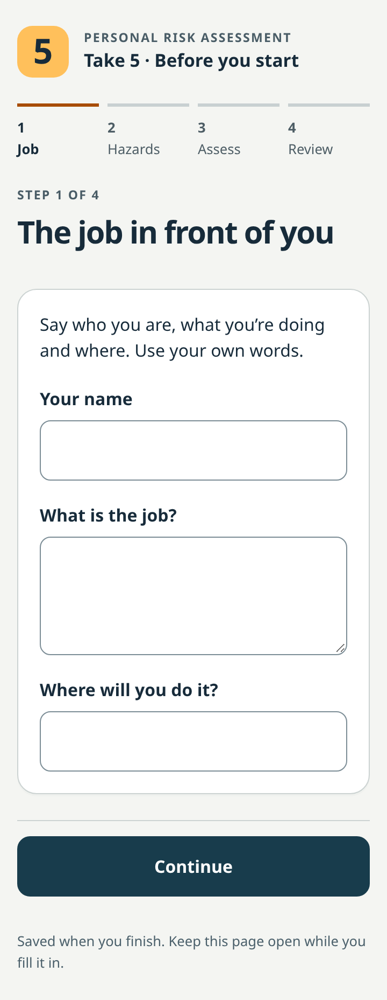
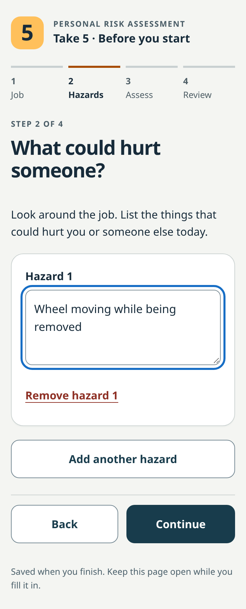
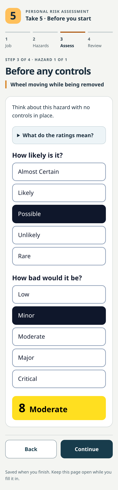
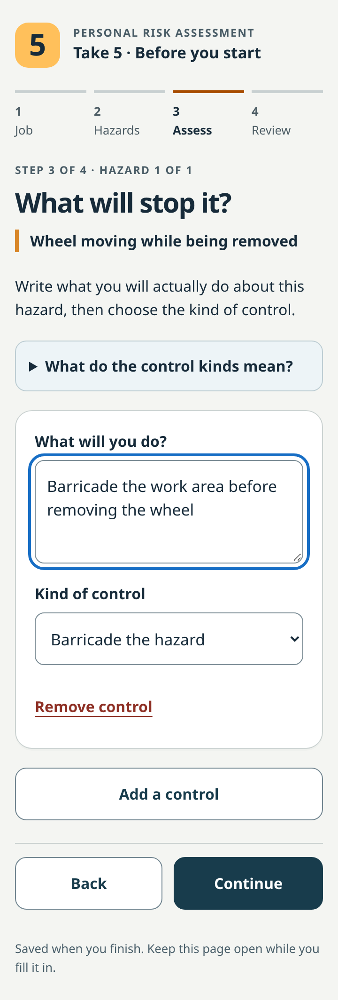
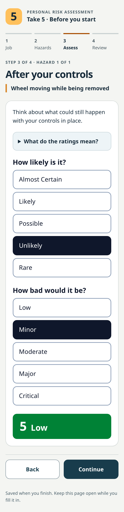
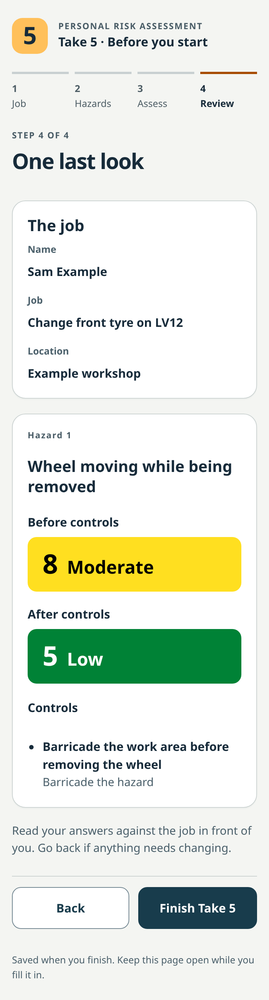
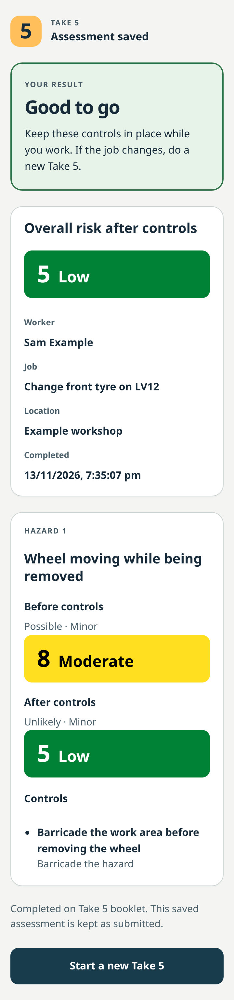
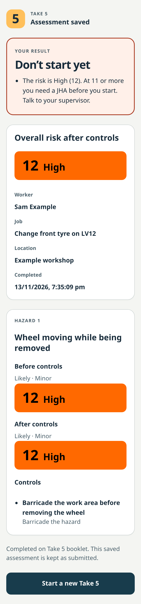
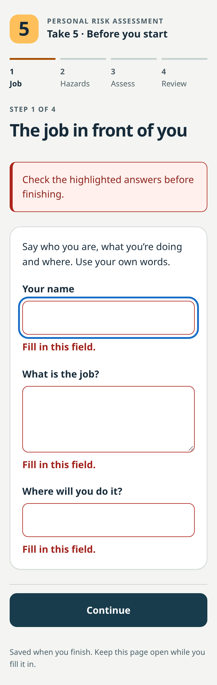

# Task 0004 review

The worker can now fill in and save a Take 5 from the home page. Jake chose their own phone at the job,
one hazard at a time, and labels with expandable guidance. Those choices are recorded in the spec and decisions.

## Try the flow

Check out `chatgpt/0004-take5-ui`, run `uv run scripts/dev.py` from the repository root and open
<http://localhost:5173>. Enter fake details, list a hazard, rate it before controls, add a control and rate it
afterwards. Review and finish. Reopen the saved URL, then start another assessment to check the remembered name.

Try a hazard with no controls: the second rating is skipped and the saved result explains why work cannot start.
Try a high after rating to see the JHA reason. Missing fields and increased after risk are reported by the
server beside the relevant answers when finishing. Closing or reloading an unfinished form loses its answers.

## Reading guide

| Area | Start here | Purpose |
| --- | --- | --- |
| Draft checks | [draft.py](../../../backend/src/risk_assessment/domain/take5/draft.py) | Field errors and conversion from choices to checked ratings |
| Verdict | [verdict.py](../../../backend/src/risk_assessment/domain/take5/verdict.py) | V2 and V3 reasons in the specified order |
| Submission | [take5s.py](../../../backend/src/risk_assessment/services/take5s.py) | Checking, saving, template snapshots and retry conflicts |
| Storage | [sqlite.py](../../../backend/src/risk_assessment/storage/sqlite.py) | Atomic first-write-wins JSON persistence |
| API | [take5_routes.py](../../../backend/src/risk_assessment/api/take5_routes.py) | The four endpoints and HTTP errors |
| Phone flow | [NewTake5Screen.tsx](../../../frontend/src/features/take5/NewTake5Screen.tsx) | Draft state, steps, errors and finishing |
| Review | [ReviewDraft.tsx](../../../frontend/src/features/take5/ReviewDraft.tsx) | Final review using the supplied matrix |
| Saved result | [Take5ResultScreen.tsx](../../../frontend/src/features/take5/Take5ResultScreen.tsx) | Saved verdict, reasons, controls and ratings |
| Browser checks | [take5.spec.ts](../../../frontend/e2e/take5.spec.ts) | Worker flows, retry failures and phone dimensions |

The API and generated types are in PR #8. The screens PR is based on that branch so each diff is reviewable.
Reusable rating, control and field components remain in `frontend/src/components/`. No dependencies were added.
The backend owns validation and verdicts; the browser selects a display cell from the supplied matrix.

## Validation

`uv run scripts/check.py` passed: 74 Python tests, five frontend tests and ten browser tests, together with all
lint, format, strict type and generated API checks. Browser tests use an isolated temporary SQLite file.
They test missing answers, R6, no controls, both verdicts, back navigation, multiple hazards, blocked duplicate
clicks and retries after a lost response. A changed retry cannot overwrite the original saved assessment.

The cloud blocked Playwright's browser-download CDN. Tests used installed Chromium 156 through an external
cache link, with the project's browser configuration unchanged. Screenshots were inspected at a 360 px CSS
viewport (2× pixel density). Tests check no horizontal overflow and visible tap targets at least 48 px high.
Physical sunlight/glove use still needs a worker's review. Screenshots use fake example data, en-AU locale and
Australia/Perth time; generated assessment timestamps vary between runs.

## Phone screenshots

### Job details

### Own-word hazards

### Before controls

### Controls

### After controls

### Review

### Good to go

### Do not start

### Field errors

Browser tests require their own API process and refuse to reuse a running development API, so fake test
assessments cannot be written to the development database. Stop the development server before running them.
